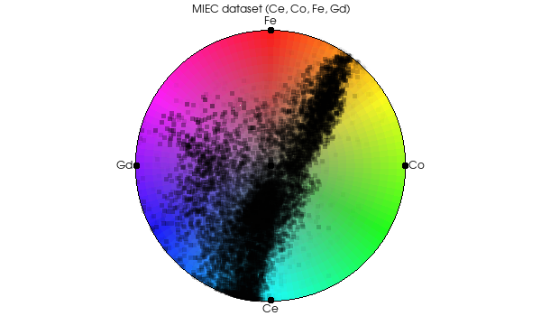
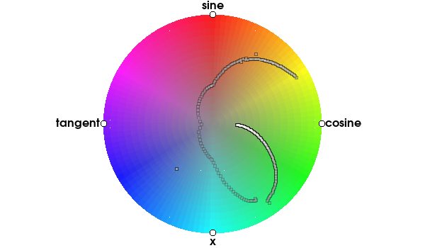

## vtkMultiVariateToRGBA

Maps multivariate data (multi-component point or cell scalars in a
vtkDataSet, or one-component numeric columns in a vtkTable) to color
and opacity (RGBA). The filter can also generate
two additional set of point coordinates. First, point coordinates
for vertices associated with the components on the outline of a
circle centered at (0, 0) with radius 1 (these points form a
polygon). Second, points associated with the data (generalized
barycentric coordinates (GBC) inside the vertices polygon, scaled
to cover the circle) (see StoreRGBA, StoreVertices, StoreGBC).
The color and opacity can be used to volume render the dataset.

A lens (LensCenter, LensRadius) caps the opacity of the points outside
it (OutsideLensAlpha, InvertLens). When only the lens changes, only the
opacity is recomputed, so the lens can be dragged interactively.
Variables can be hidden (SetVariableVisibility) and normalized in
groups (SetPartitionIndices) or to custom ranges (SetCustomRange). The
filter runs in parallel with a vtkMultiProcessController.

## vtkPlotRadViz, vtkChartRadViz
Radial plot of multivariate data (a tuple with multiple components
corresponds to a point) that shows the relations among these
variables (components). The plot accepts either a vtkTable or a
vtkDataSet as input. It uses vtkMultiVariateToRGBA to compute the
point generalized barycentric coordinates (GBC) and the color
(RGBA) for a tuple. The point position and color represent the
normalized value of each component in relation to each other while
the opacity represents the average normalized value for all
components. For example, in three-component data, both (0.1, 0.1,
0.2) and (0.4, 0.4, 0.8) will have the same point position and
color but the second point will be 4 times more opaque.

vtkChartRadViz handles the interaction for vtkPlotRadViz: dragging a
vertex rotates the vertices, and dragging the lens moves or resizes it.

*RadViz chart of a vtkDataSet: the four-component (Ce, Co, Fe, Gd)
point scalars of the MIEC dataset, drawn over the color wheel.*

*RadViz chart of a vtkTable: the columns sine, cosine, x and tangent
are the vertices on the circle and each row is a point.*
