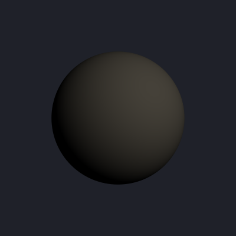
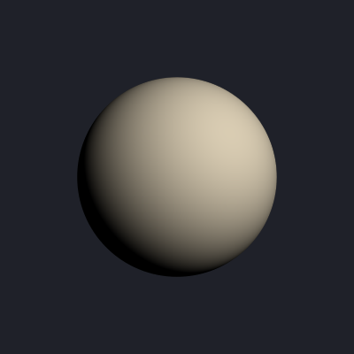

## ANARI now renders directional lights as brightly as the OpenGL backend

Scenes lit by directional lights looked much darker through ANARI than they did
through the OpenGL backend. Directional lights are now scaled the same way point
and spot lights already were, so a scene keeps its brightness when you render it
with ANARI.

| Before | After |
|:------:|:-----:|
|  |  |
