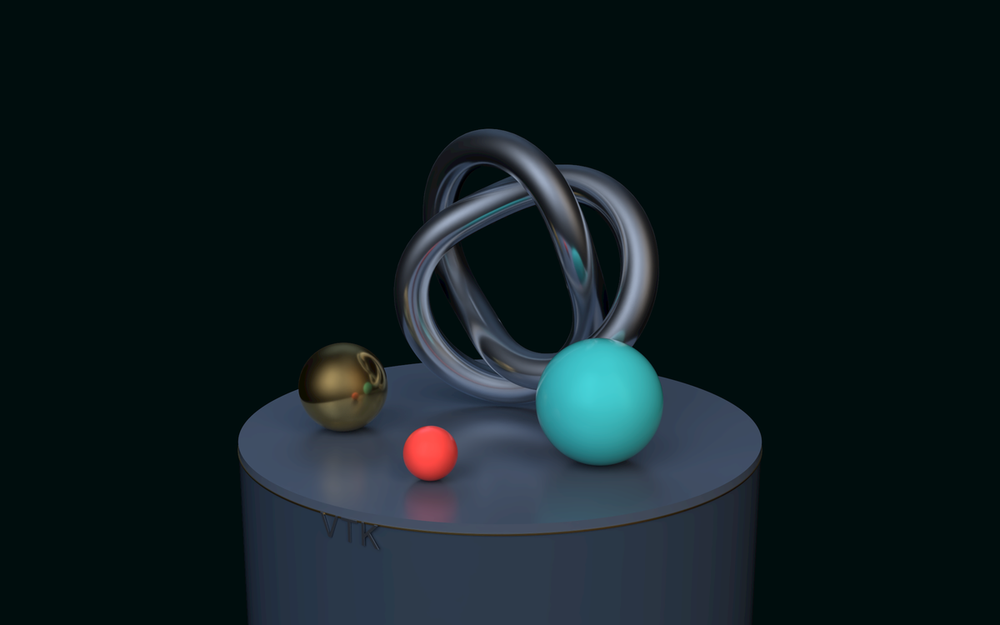
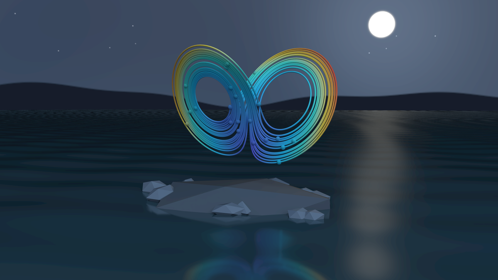
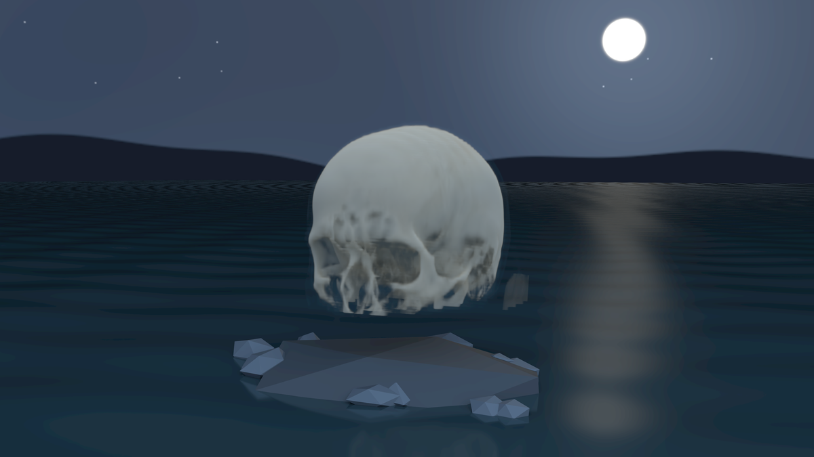

## Fix skybox brightness with ANARI

`vtkAnariPass` now draws skyboxes with their OpenGL shader, preserving projection,
gamma correction, and foreground depth. Skyboxes no longer become illuminated
geometry in the ANARI scene.

Environment textures used as HDRI lights now normalize unsigned-char colors and
convert sRGB colors to linear radiance. Linear floating-point HDR values retain
their range. Changes to environment textures or the image-based lighting setting
also update the ANARI light.

Polished metals and glazed ceramics illuminated by a studio HDRI.

Lorenz convection trajectories colored by phase-space speed above moonlit water.

Direct volume rendering of the Slicer CTBrain sample illuminated by a moonlit HDRI.
