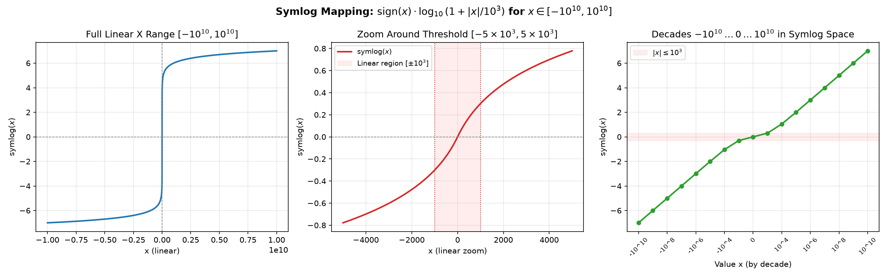
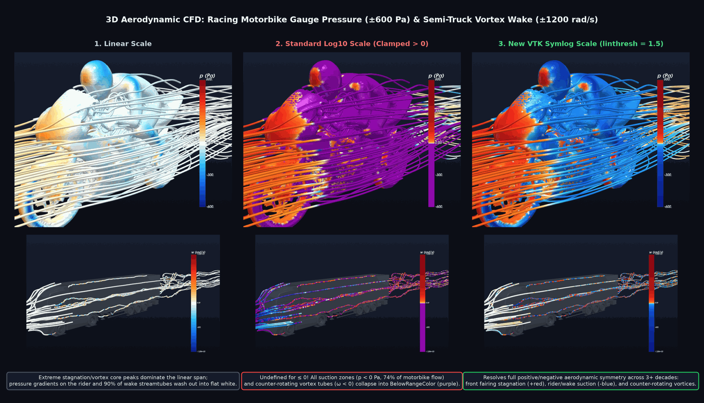
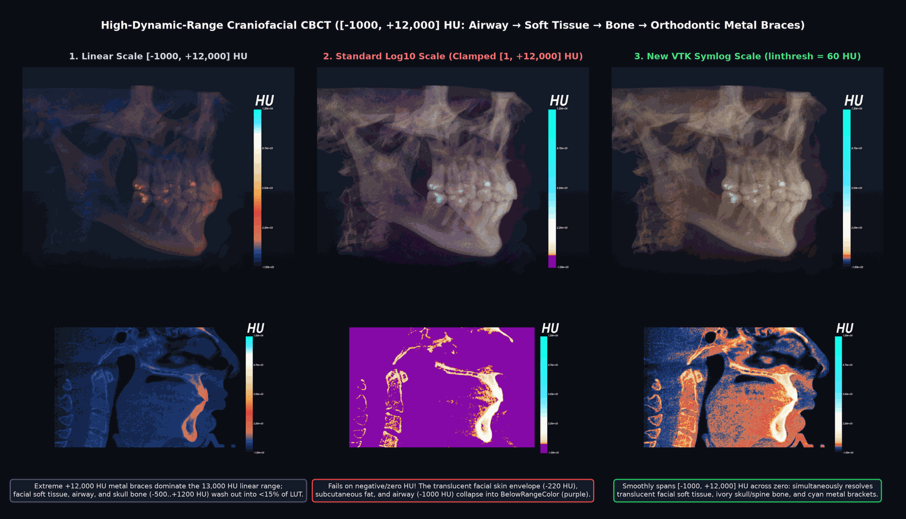
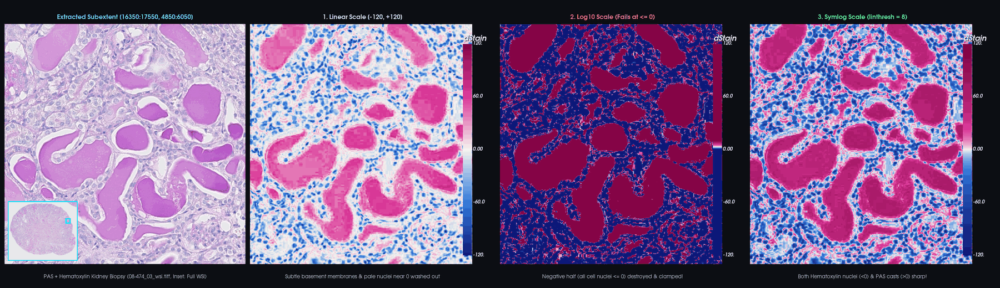

## Symmetric logarithmic (`Symlog`) color scaling in `vtkLookupTable` and `vtkColorTransferFunction`

`vtkLookupTable` and `vtkColorTransferFunction` now support symmetric
logarithmic (`VTK_SCALE_SYMLOG`) color scaling. You can now map scalar fields
that span multiple orders of magnitude and include zero or negative values
without clamping, `NaN` errors, or loss of contrast near zero.

### How it works

Standard linear scaling (`VTK_SCALE_LINEAR`) distributes color bins uniformly
between `[min, max]`, which compresses subtle variations near zero when large
positive or negative peaks are present. Standard logarithmic scaling
(`VTK_SCALE_LOG10`) is undefined for values $\le 0$ and discards zero and
negative values.

Symmetric logarithmic scaling maps the entire real line $(-\infty, +\infty)$
using a smooth, continuous transformation:

$$f(x) = \operatorname{sign}(x) \cdot \log_{10}\!\left(1 +
\frac{|x|}{C}\right)$$

where $C > 0$ is the linear threshold (`SymlogLinearThreshold`):

* **Near zero ($|x| \ll C$):** The transformation behaves linearly and passes
  smoothly through $(0, 0)$ with finite slope.
* **Far from zero ($|x| \gg C$):** The transformation behaves logarithmically
  on both the positive and negative sides, compressing extreme values
  symmetrically across decades.



### Usage

You can enable `Symlog` scaling and configure the linear threshold on both
`vtkLookupTable` and `vtkColorTransferFunction`:

```cpp
#include <vtkColorTransferFunction.h>
#include <vtkLookupTable.h>
#include <vtkNew.h>

vtkNew<vtkLookupTable> lut;
lut->SetTableRange(-1200.0, 1200.0);
lut->SetSymlogLinearThreshold(1.5);
lut->SetScaleToSymlog();
lut->Build();

vtkNew<vtkColorTransferFunction> ctf;
ctf->SetSymlogLinearThreshold(60.0);
ctf->SetScaleToSymlog();
ctf->AddRGBPoint(-1000.0, 0.03, 0.04, 0.08);
ctf->AddRGBPoint( -200.0, 0.84, 0.48, 0.35);
ctf->AddRGBPoint(    0.0, 0.86, 0.28, 0.24);
ctf->AddRGBPoint( 1200.0, 0.98, 0.95, 0.86);
ctf->AddRGBPoint(12000.0, 0.05, 1.00, 0.92);
```

### Examples

#### 3D Aerodynamic CFD (Gauge Pressure and Vortex Wake Angular Velocity)

Visualizing signed aerodynamic gauge pressure ($p$ from -600 to +600 Pa) for
motorbike and angular velocity ($\omega$ from -1200 to +1200 rad/s) in a
semi-truck wake, linear scaling oversimplifies the surface and wake colors.
Log10 scaling does not effectively represent suction zones ($p < 0$) and
counter-rotating vortices ($\omega < 0$). In contrast, Symlog scaling captures
stagnation peaks, zero-crossings, suction regions, and counter-rotating wake
vortices effectively.



#### High-Dynamic-Range 3D Craniofacial CBCT Volume Rendering

Clinical CT and CBCT volumes, measured in Hounsfield Units (HU), range from
negative values for airways (-1000 HU) and facial soft tissues (-450 to -80 HU)
to very high values for materials like tooth enamel and metal appliances
(+12,000 HU). `Symlog` scaling captures both the negative facial skin values
and the high values for bone and metal in one function.



#### Digital Pathology Whole-Slide Imaging (Signed Stain Differential)

In quantitative digital pathology, differential stain mapping differentiates
basophilic nuclei stained with Hematoxylin from PAS-positive hyaline casts and
tubular membranes. It delineates these elements around unstained tubular
lumens. `Symlog` scaling effectively visualizes delicate membranes, hyaline
casts, and cell nuclei across zero, enhancing clarity without restricting
negative nuclear stain densities.



*Kidney pathology dataset credit: Yucheng Tang, Yufan He, Vishwesh Nath,
Pengfeig Guo, Ruining Deng, Tianyuan Yao, Quan Liu, Can Cui, Mengmeng Yin,
Ziyue Xu, Holger Roth, Daguang Xu, Haichun Yang, Yuankai Huo. "HoloHisto:
End-to-end Gigapixel WSI Segmentation with 4K Resolution Sequential
Tokenization." arXiv preprint
[arXiv:2407.03307](https://arxiv.org/abs/2407.03307) (2024).*
