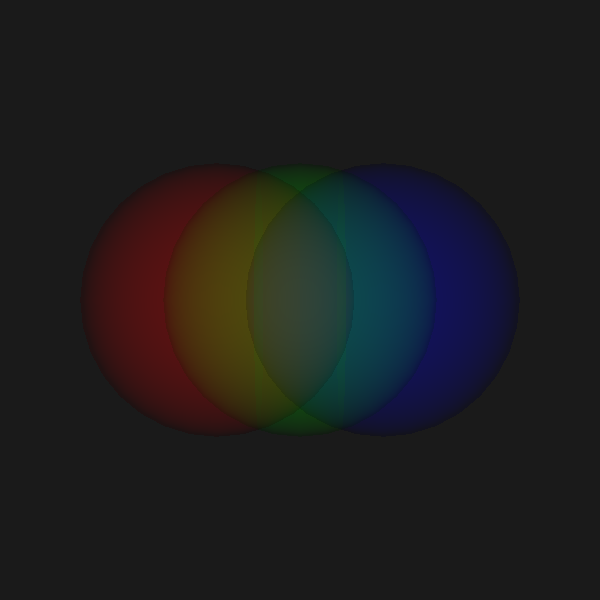

## Faster first and successive frames in the WebGPU backend

The WebGPU backend draws its first frame much faster. `vtkWebGPUPolyDataMapper`
used to compile all 14 graphics pipeline variants (points, lines, thick lines,
triangles, homogeneous cell sizes and so on) the first time it rendered an
actor. It now builds only the pipelines the actor draws with, taken from its
display properties and from the topology bound to the renderer. Of the two
cell-id variants of a pipeline, only the one matching the cell size of the data
is ever bound, so only that one gets built. A triangulated surface of uniform
cell size now compiles one pipeline instead of two.

The mapper submits those pipelines together through the new
`vtkWebGPURenderPipelineCache::CreateRenderPipelineAsync()` and waits for them
once with `WaitForPendingRenderPipelines()`, which lets the implementation
compile them on its own threads: 0.89s rather than 1.83s for 14 pipelines.
Opening the WebGPU implementation library no longer waits for the platform
window either, which saves roughly 40ms.

Measured first frames: a simple translucent spheres benchmark dropped from
~17.2s to ~3.9s from the narrower pipeline set alone, and three spheres with
visible edges at 250x250 dropped from ~2.1s to ~0.46s with all of the above.

Successive frames are faster too. `vtkWebGPURenderer::Clear()` used to rebuild
the background pipeline on every frame. On screen the display refresh interval
hid almost exactly that much time, so the cost went unnoticed. `Clear()` now
reuses the cached pipeline, and `GetPipelineKey()` also hashes the pipeline's
fixed-function state: blend, depth-stencil, color targets and vertex layout, so
the entry returned is the one the descriptor asked for.

The table below lists median offscreen frame times, where no presentation
throttles either backend to the display refresh rate. They come from a Debug
build on a macOS arm64 machine, so read the ratios rather than the absolute
numbers.

| Scene (250x250 unless noted)     | WebGPU | OpenGL |
|----------------------------------|--------|--------|
| Empty renderer                   | 0.15ms | 0.36ms |
| One sphere                       | 0.22ms | 0.74ms |
| Three spheres with visible edges | 0.33ms | 0.90ms |
| Three 64x64 spheres at 1000x1000 | 0.33ms | 0.96ms |

Tracking the line join alongside the other display properties also fixes
`vtkProperty::SetLineJoin()` being silently ignored after the first frame when
render bundles are on.
